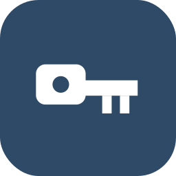

# TokenTools

<p align="center">
  
</p>

<p align="center"><strong>Инструменты для работы с контейнерами КриптоПро на аппаратных токенах</strong></p>

<p align="center">
  <a href="https://github.com/DarkMuchHigher/TokenTools/actions/workflows/ci.yml"></a>
  <a href="https://github.com/DarkMuchHigher/TokenTools/releases/latest"></a>
  
  <a href="LICENSE"></a>
</p>

TokenTools читает контейнеры КриптоПро через PC/SC, выгружает файлы, разбирает сертификаты, проверяет контейнеры через CryptoPro CSP и запускает CertFix через `p12utility`.

В составе проекта — CLI и нативный GUI на egui/eframe. Готовые сборки: [Releases](https://github.com/DarkMuchHigher/TokenTools/releases). История версий — [CHANGELOG.md](CHANGELOG.md).

> Проект учебный: он показывает, как устроены контейнеры КриптоПро, файловая система токена
> и обмен APDU. Используйте его на своих носителях и в законных целях. Подробнее
> в разделе [Назначение и правовая информация](#назначение-и-правовая-информация).

## Возможности

- поиск PC/SC-считывателей;
- перечисление файловой системы токена по APDU;
- PIN-авторизация со счётчиком попыток;
- выгрузка шестифайловых контейнеров;
- разбор `name.key`, `header.key`, сертификата владельца и цепочки УЦ;
- имя контейнера по CN сертификата владельца (CLI и GUI);
- разбор X.509: субъект, издатель, сроки, отпечатки SHA-1/SHA-256;
- проверка контейнера через CryptoPro CSP;
- обработка контейнера с резервной копией и откатом;
- извлечение и установка сертификатов, экспорт в PEM;
- просмотр личных сертификатов КриптоПро (хранилище `uMy`);
- установка контейнера в хранилище КриптоПро или на флешку;
- короткие каталоги контейнеров, собранные из CN, и команда `repair` для уже установленных;
- привязка сертификата владельца к ключу в `uMy` (флаг `--link`);
- диагностика окружения командой `doctor`.

Файлы выгруженного контейнера:

```text
name.key       header.key       primary.key
masks.key      primary2.key     masks2.key
```

## Поддерживаемые носители

Токены с APDU-файловой системой (PC/SC). Проверено на Рутокен Lite (ATR `3b 8b 01 "Rutokenlite"`).
Список носителей расширяется.

## Как читаются контейнеры

Папки контейнеров лежат в файловой системе токена: корень `1000:1003`, сами папки —
`0A00`, `0B00`, `0C00`… (диапазон `folders=0A00..1800` из конфигурации CryptoPro CSP).
Внутри папки файлы различаются ролью: **FID файла = FID папки + роль**.

| роль | файл | роль | файл |
| --- | --- | --- | --- |
| 1 | `masks.key` | 4 | `masks2.key` |
| 2 | `primary.key` | 5 | `primary2.key` |
| 3 | `header.key` | 6 | `name.key` |

APDU (проверено на живых токенах):

| Шаг | Команда |
| --- | --- |
| выбор MF | `00 A4 00 00 02 3F 00 00` |
| выбор по пути | `00 A4 09 04 <Lc> <FID16 BE…> 00` |
| выбор по FID | `00 A4 00 00 02 <FID BE> 00` |
| перечисление: первая запись | `00 A4 00 04 00` |
| перечисление: следующая | `00 A4 00 06 02 <FID BE> 00` |
| возврат в родителя | `00 A4 03 00` |
| чтение | `00 B0 <P1 P2> <Le>` кусками по 220 байт |

Идентификаторы файлов передаются **big-endian**. Имя файла определяется ролью, а не порядком
обхода: порядок записей в папке на токене произвольный. Имя контейнера берётся из `name.key`,
каталог выгрузки называется по имени контейнера, а если имени нет — по FID папки.
`--verbose` печатает APDU-трассу; данные VERIFY в журнал не попадают.

## Назначение и правовая информация

Проект написан для обучения: по нему удобно разбираться, как устроены контейнеры КриптоПро,
файловая система токена и обмен APDU. Автор не связан с ООО «КРИПТО-ПРО» и производителями
токенов; их названия упоминаются только для описания совместимости. Код идёт «как есть»,
без гарантий, и вся ответственность за использование лежит на вас.

Работайте только с теми носителями, ключами и сертификатами, на которые у вас есть права.
Перед использованием сверьтесь с лицензией своего ПО (для CryptoPro CSP это обязательно),
правилами организации и применимым законодательством, включая требования к защите ключей
и экспортные ограничения.

Отдельно про `fix`: команда снимает с ключа признак неэкспортируемости, то есть снижает его
защиту. Применяйте её к своим ключам и только осознанно.

Сторонние утилиты (CryptoPro CSP, `p12utility.win32.exe`, драйверы токенов) в репозиторий не
входят. Они остаются под своими лицензиями, и на этот код они не распространяются. Не
публикуйте их вместе со сборками.

## Быстрый старт

### Сборка

```bash
cargo build --workspace --release --locked
```

### Проверка окружения

```bash
cargo run --release -p tokentools -- doctor
```

Команда показывает состояние PC/SC, считывателей, Wine/Flatpak, `p12utility`, `csptest` и `certmgr`.

### CLI

```bash
# Список считывателей
cargo run --release -p tokentools -- list

# Выгрузка контейнеров (каталоги называются по имени контейнера)
cargo run --release -p tokentools -- dump ./dump

# Выгрузка с явным PIN
cargo run --release -p tokentools -- dump ./dump --pin 87654321

# Подробный вывод обхода файловой системы
cargo run --release -p tokentools -- --verbose dump ./dump

# Проверка контейнера
cargo run --release -p tokentools -- verify ./dump/<container>

# Извлечение сертификатов
cargo run --release -p tokentools -- cert ./dump/<container>

# Состав сертификатов, отпечатки SHA-1/SHA-256 и PEM
cargo run --release -p tokentools -- cert ./dump/<container> --show --pem

# Извлечение и установка сертификатов
cargo run --release -p tokentools -- cert ./dump/<container> --install

# CertFix-процесс
cargo run --release -p tokentools -- fix ./dump/<container>

# Контейнеры в хранилище КриптоПро и на флешках
cargo run --release -p tokentools -- storage

# Переименовать каталоги, которые КриптоПро не видит (> 8 символов или не-ASCII)
cargo run --release -p tokentools -- repair

# Установить контейнер в хранилище КриптоПро (HDIMAGE)
cargo run --release -p tokentools -- deploy ./dump/<container> --name mykey --link

# Установить контейнер на флешку (корень смонтированного тома)
cargo run --release -p tokentools -- deploy ./dump/<container> /run/media/$USER/<метка> --name mykey

# Удалить контейнер из хранилища КриптоПро
cargo run --release -p tokentools -- unmount mykey
```

Если `p12utility.win32.exe` не находится автоматически:

```bash
export TOKENTOOLS_P12UTILITY=/path/to/p12utility.win32.exe
```

PowerShell:

```powershell
$env:TOKENTOOLS_P12UTILITY = "C:\Tools\p12utility.win32.exe"
```

### PIN

Чтение контейнеров требует авторизации. PIN берётся в порядке:

1. `--pin` у команды `dump`;
2. переменная окружения `TOKENTOOLS_PIN`.

Если PIN не задан, команда завершается с ошибкой: подставлять PIN по умолчанию вслепую нельзя, это тратит счётчик попыток.

Перед вводом команда читает счётчик попыток. При неверном PIN выгрузка останавливается с указанием остатка попыток, чтобы не израсходовать их повторными вводами. Заблокированный PIN разблокируется через панель управления токеном или админ-PIN.

Чтение ключевых файлов (`masks.key`, `primary.key`, `masks2.key`, `primary2.key`) требует
авторизации: без PIN токен отвечает `SW=6982`.

```bash
export TOKENTOOLS_PIN=87654321
```

### GUI

```bash
cargo run --release -p tokentools-gui
```

- **Токен**: PIN пользователя, список контейнеров, сохранение на диск. Имя контейнера — CN сертификата владельца из `header.key`, рядом техническое имя из `name.key`. После неверного PIN автопоиск останавливается до нажатия «Прочитать токен».
- **Контейнер**: проверка, снятие неэкспортируемости, сертификаты и установка в хранилище КриптоПро или на найденную флешку.
- **Хранилище**: контейнеры в каталоге ключей КриптоПро и на флешках. Первой строкой — CN сертификата владельца, ниже техническое имя из `name.key`, папка и место. Кнопка «Подробнее» открывает адрес контейнера в КриптоПро, файлы с размерами, данные сертификата владельца и готовую команду проверки. Действия: проверка, установка сертификата в `uMy`, удаление.
- **Сертификаты**: публичные сертификаты из `uMy` с поиском; каждый ссылается на ключевой контейнер.
- **Журнал**: операции, вывод утилит КриптоПро и трасса APDU. Фильтр «только ошибки», «основное» и «всё с трассой»; по умолчанию трасса скрыта. Время в журнале — UTC.

Иконка в доке и меню (Linux): скопируйте `tokentools.desktop` в `~/.local/share/applications/`, а `tokentools.png` в `~/.local/share/icons/hicolor/128x128/apps/`. В релизных архивах оба файла лежат рядом с бинарниками.

## Установка контейнера в КриптоПро

Сохранённый контейнер можно установить так, чтобы КриптоПро видел его как обычный носитель и им можно было подписывать. Ключ остаётся на диске или флешке.

| Куда | Каталог | Имя в КриптоПро | Пароль при подписи |
| --- | --- | --- | --- |
| Хранилище (HDIMAGE) | `/var/opt/cprocsp/keys/$USER/<каталог>.000` | `\\.\HDIMAGE\<имя>` | не нужен |
| Флешка | `<корень тома>/<каталог>.000` | `\\.\<UUID тома>\<имя>` | запрашивается |

Имя контейнера КриптоПро берёт из файла `name.key`, а не из имени каталога. Каталог в хранилище
HDIMAGE не должен быть длиннее 8 символов, поэтому TokenTools собирает его из CN сертификата
владельца: кириллица транслитерируется, служебные формы («ООО», «АО», «LLC») отбрасываются,
результат обрезается до 8 символов. Для `ООО "ПИТЕРСТРОЙ"` получается каталог `piterstr.000`.
Если сертификата нет, имя берётся из `name.key`, а если и его нет — случайное `t….000`.
Полное имя всё равно записывается в `name.key`.

Имя из `name.key` должно быть уникальным: КриптоПро адресует контейнер по имени и не различает
два контейнера с одним именем. Установка туда, где такое имя уже занято, останавливается с
указанием каталога существующего контейнера. Если контейнер с тем же именем лежит на
подключённом токене, КриптоПро выберет токен и запросит PIN, поэтому для копий задавайте своё
имя (`--name`).

Каталоги, установленные ранее с длинными или не-ASCII именами, переименовывает команда `repair`.
Рабочие каталоги она не трогает: в сертификате хранилища `uMy` записан путь вида
`HDIMAGE\<каталог>\<ключ>`, поэтому переименование разорвало бы привязку сертификата к ключу.

Флешка определяется автоматически: подходят USB-тома, смонтированные в `/proc/mounts`. КриптоПро ищет контейнеры только в корне тома, поэтому установка в подпапку флешки отклоняется. Имя тома в КриптоПро совпадает с UUID из `/dev/disk/by-uuid`, например `7EB2-EB0C`.

Флаг `--link` извлекает сертификат владельца из `header.key` и привязывает его к ключу в хранилище `uMy` (`certmgr -install -container`); рядом с контейнером остаётся `cert_exchange.cer`. После этого можно подписывать по отпечатку:

```bash
csptest -lowsign -sign -in file.txt -out file.p7s -detached -my <отпечаток> -add -alg GOST12_256
csptest -lowsign -verify -in file.txt -signature file.p7s -detached -my <отпечаток>
```

## Подпись документов

```bash
# хеш файла
csptest -keyset -hash GOST12_256 -in file.txt -hashout file.hsh

# подпись «сырым» ключом контейнера (64 байта, ГОСТ Р 34.10-2012)
csptest -keyset -container '\\.\HDIMAGE\mykey' -keytype exchange -sign GOST12_256 \
  -in file.txt -out file.sig -password <PIN>

# отсоединённая CMS/PKCS#7-подпись (CAdES-BES) сертификатом из хранилища
csptest -lowsign -sign -in file.txt -out file.p7s -detached -my <отпечаток> -add -alg GOST12_256
csptest -lowsign -verify -in file.txt -signature file.p7s -detached -my <отпечаток>
```

`cryptcp -sign -detached -der -cert -cadesbes -pin <PIN> '<КПС>' file` тоже делает CMS,
но адресует контейнер как файл носителя и с токен-контейнерами не работает.

## Workspace

| Пакет | Назначение |
| --- | --- |
| `pcsc-transport` | PC/SC-транспорт: динамическая загрузка libpcsclite / winscard. |
| `rutoken-fs` | Обход файловой системы токена по APDU. |
| `cryptopro-container` | Разбор имён, `header.key` и сертификатов. |
| `certfix` | CryptoPro CSP, Wine/Flatpak, проверка и обработка контейнеров. |
| `tokentools` | CLI: `list`, `doctor`, `dump`, `fix`, `verify`, `cert`, `storage`, `repair`, `deploy`, `unmount`. `storage` печатает CN, папку, издателя, сроки и отпечатки. |
| `tokentools-gui` | Desktop-интерфейс на egui/eframe. |

## Окружение

- Rust `1.99` или новее;
- `pcscd` и драйвер PC/SC токена в Linux;
- CryptoPro CSP для `verify` и установки сертификатов;
- Wine или Flatpak `org.winehq.Wine` для `fix`;
- `p12utility.win32.exe` для CertFix.

## Разработка

```bash
cargo fmt --all -- --check
cargo clippy --workspace --all-targets --locked -- -D warnings
cargo test --workspace --all-targets --locked
cargo build --workspace --release --locked
```

Конвенции проекта и обязательные проверки — в [`AGENTS.md`](AGENTS.md).

## CI

[`.github/workflows/ci.yml`](.github/workflows/ci.yml) проверяет форматирование, Clippy, тесты и release-сборку на Ubuntu и Windows.

Для обычных push создаются:

```text
TokenTools-linux-x86_64.tar.gz
TokenTools-windows-x86_64.zip
```

Тег вида `vX.Y.Z` публикует оба архива как GitHub Release.

## Лицензия

Исходный код Rust распространяется по лицензии MIT. В начале [`LICENSE`](LICENSE) — оговорка
про назначение проекта и сторонние компоненты, по-русски и по-английски.
